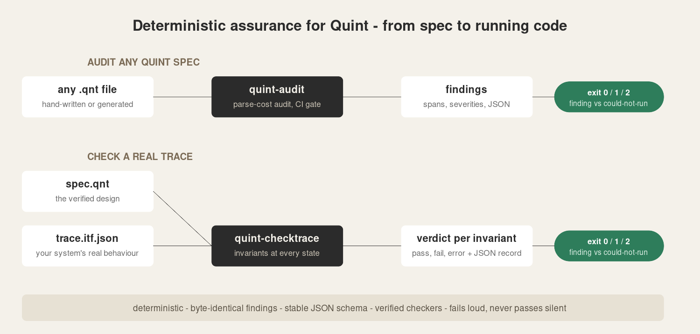

# Mimosa Grove

Verification instruments for formal specifications. The repositories here are deterministic, CI-native tools that check specification artefacts 

| instrument | what | version |
|---|---|---|
| [quint-audit](https://github.com/Mimosa-Grove/quint-audit) | a deterministic linter for [Quint](https://github.com/quint-co/quint) specifications: decodes quint's parse IR, reports structural findings with spans, severities, suggestions and exit codes; runs at parse cost in CI | 0.1.0 |
| [quint-checktrace](https://github.com/Mimosa-Grove/quint-checktrace) | a deterministic checker for [Quint](https://github.com/quint-co/quint) specifications: it compares a recorded trace with the spec, evaluates your named invariants with quint's own evaluator at every recorded state, and reports pass, fail or error per invariant. It writes a human report and a JSON record for CI. | 0.1.0 |

<picture>
  <source media="(prefers-color-scheme: dark)" srcset="assets/mg-pipeline-dark.png">
  
</picture>

## Verification discipline

Every instrument states its contract and proves what it can.

quint-audit's check semantics are written as Quint specs and bounded-model-checked. A mutant counts as killed only when two independent instruments fail it.

quint-checktrace's checker contract is pinned by three JSON schemas, regression-checked against a 134-fixture net, and accepted against a 67-spec corpus of real Quint files. Its gate replays that evidence on every run and prints a marker, so a crashed gate is never mistaken for a pass.

Both instruments separate a finding from a could-not-run by exit code. An instrument that cannot run never passes a gate.

## CI

Repositories are CI-gated on GitLab and GitHub Actions, per push.

## Licence

Each repository carries its own `LICENSE`, generally AGPL-3.0.
